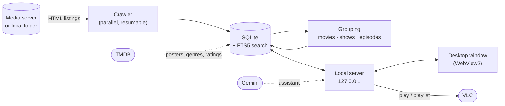

<div align="center">


# medialib

**Turn any folder-listing media server into a Netflix-style library on your desktop.**

Point it at a link like `http://server/Movies/`. medialib scans every folder,
groups the files into movies and TV shows with posters, and lets you browse,
search and play them in VLC or right inside the app.


</div>

---

## Why medialib?

Many home, campus and ISP media servers (the kind that show a plain list of
folders and files in the browser) hold huge collections. Finding something to
watch means clicking through dozens of folders. medialib indexes it all once
and gives you a real library:

- 🎬 **Posters, not folders.** Movies and shows get their own cards, and each
  show page lists its seasons and episodes.
- ⚡ **Instant search.** Results appear as you type, across 40,000+ titles,
  without touching the network.
- ▶️ **One-click play.** Videos open in VLC, playlists play whole seasons back to
  back, and MP4s can play inside the app.
- 🧠 **A watch assistant that only suggests what you actually have.**

It has been used on a real library of **35,000+ movies and 5,000+ shows** (over
210,000 video files) spread across several servers.

## Features

<table>
<tr>
<td width="50%" valign="top">

### 📚 Library
- Movies and TV shows grouped automatically from folder and file names
- Posters taken from the server's own folder images, or from TMDB
- **Dual Audio**, **Multi Audio** and **Ongoing** badges
- Filters: year, genre, quality, platform (Netflix, Prime…), folder, audio, status
- Sorting: recently added or updated, title, newest, top rated
- Each source has its own page in the sidebar

</td>
<td width="50%" valign="top">

### 📺 Show pages
- Backdrop, poster, rating, genres, country, plot and credits
- Season tabs with episode titles, air dates, runtimes and stills
- **Up next** follows what you watched last
- Watched ticks on every episode
- When an episode exists twice (dubbed and original), you choose the version
- **Play as playlist** sends the rest of the season to VLC

</td>
</tr>
<tr>
<td valign="top">

### 🔄 Sources and sync
- Add any directory-listing link, or a folder on your PC
- *Check link* tests a link and guesses whether it holds movies or TV shows
- Background sync with a live progress pill and a stop button
- Interrupted syncs resume where they stopped
- **Full rescan** removes files that are gone from the server

</td>
<td valign="top">

### ✨ Extras
- **Watch assistant** (Google Gemini): ask in any language, for example
  *"a slow-burn Korean thriller"*
- **Movie info** from TMDB: genres, ratings, plots, episode names
- Watchlist and *Recently played*
- **Ctrl K** search from anywhere
- A command-line tool built on the same library

</td>
</tr>
</table>

## Screenshots

<table>
<tr>
<td width="50%"><p align="center"><b>Search:</b> instant results across movies and shows</p></td>
<td width="50%"><p align="center"><b>TV Shows:</b> ongoing and audio badges, status filter</p></td>
</tr>
<tr>
<td><p align="center"><b>Show page:</b> seasons, episodes, Up next</p></td>
<td><p align="center"><b>Movie page:</b> every version of a film in one place</p></td>
</tr>
<tr>
<td colspan="2"><p align="center"><b>Sources:</b> add links, check them, and watch each one sync</p></td>
</tr>
</table>

## Getting started

### Requirements

| | |
|---|---|
| **OS** | Windows 10 or 11 (the window uses Microsoft Edge WebView2, which Windows 11 already has) |
| **Player** | [VLC](https://www.videolan.org/vlc/), or any player that accepts a URL |
| **To build** | [Rust](https://rustup.rs) (stable) and the MSVC Build Tools (the C++ workload) |

### Build and run

```powershell
git clone https://github.com/coderasraf/Medialib.git
cd Medialib
cargo build --release
.\target\release\medialib-desktop.exe
```

The build produces two programs:

| File | What it is |
|---|---|
| `medialib-desktop.exe` | the desktop app |
| `medialib.exe` | the command-line tool |

> [!NOTE]
> If the build fails with *"An Application Control policy has blocked this
> file (os error 4551)"*, Windows **Smart App Control** is blocking the build
> scripts that cargo compiles. Build with Smart App Control turned off, or
> under WSL.

### First run

1. Open **Settings → Sources** and paste a folder link, for example
   `http://192.168.1.10/Movies/`. Choose **Movies** or **TV shows**, then click
   **Add and sync**. Use **Check link** first if you're not sure which type it is.
2. Watch the progress pill at the top right. Titles appear as each source
   finishes syncing.
3. *(Optional)* **Settings → Movie info:** paste a free
   [TMDB API key](https://www.themoviedb.org/settings/api) to add genres,
   ratings, plots, backdrops and episode names.
4. *(Optional)* **Settings → AI assistant:** paste a free
   [Gemini API key](https://aistudio.google.com/apikey) to turn on the ✦
   assistant.

Settings and the library database are stored in `%APPDATA%\medialib`.

## Supported servers and folder layouts

medialib reads the plain HTML directory listings that most media servers
produce: **h5ai**, **nginx** `autoindex`, **Apache** `mod_autoindex`,
**Caddy** `browse`, **lighttpd**, and `python -m http.server`. It also reads
folders on your own PC.

It understands the layouts that media collections usually use:

```text
Movies/                                  TV Shows/
└── (2024)/                              └── Show Name (TV Series 2023– ) 720p/
    └── Movie Name (2024) 1080p/             ├── poster.jpg
        ├── poster.jpg                       ├── Season 1/
        └── Movie.Name.2024.1080p.mkv        │   ├── Show.Name.S01E01.mkv
                                             │   └── Show.Name.S01E02.mkv
                                             └── Season 2/ …
```

| From the names it reads | Examples |
|---|---|
| Title and year | `Arrival (2016)`, `(1972) Pratidwandi`, `Blade Runner 2049 (2017)` |
| Season and episode | `S01E02`, `1x02`, `Episode 05`, `Show 01.mkv` |
| Ongoing shows | `(TV Series 2023– )` |
| Quality | `2160p`, `1080p`, `720p` |
| Audio | `[Dual Audio]`, `[Multi Audio]`, `[Hindi + Tamil + Telugu]` |
| Platform | `NF`, `AMZN`, `DSNP`, `HMAX`, `ATVP`, … |
| Multi-part films | `Movie-CD1/`, `Movie-CD2/` are joined into one title |

## How it works



- **Scan once, search instantly.** Syncing walks the listings in parallel and
  stores every file in SQLite. Browsing and search only read that database, so
  they never wait on the network.
- **Grouped into titles.** After each sync, files are grouped into movies and
  shows. Watchlist entries and looked-up info stay attached to the same title
  across re-syncs.
- **Local and private.** The app's server listens only on `127.0.0.1`. Video
  and posters stream straight from your media server, and nothing is uploaded
  anywhere. The optional TMDB and Gemini features send only titles and your
  questions.
- **Grounded assistant.** Gemini suggests titles. medialib keeps only the ones
  that exist in your library, and Gemini then picks from that real list, so
  every suggestion is playable.

The engineering details (resumable crawl checkpoints, FTS5 design, and why
the crawler fetches before it writes) are in **[docs/DESIGN.md](docs/DESIGN.md)**.

## Command-line tool

The same library ships as a CLI, configured by a `config.toml` (see
[`config.example.toml`](config.example.toml)):

```powershell
medialib crawl                     # sync every source (resumes if interrupted)
medialib crawl --root nas --fresh  # re-walk one source from scratch
medialib search breaking bad       # search the index instantly
medialib play breaking bad s03e07  # open the best match in VLC
medialib serve --port 8080         # the full app UI in your browser
medialib stats                     # library size
```

## Project layout

```text
src/
├── desktop.rs    desktop window (wry + tao on WebView2)
├── main.rs       command-line tool (clap)
├── web.rs        local API + UI server (axum, loopback only)
├── ui/           the app's interface: HTML, CSS and plain JavaScript
├── crawler.rs    parallel directory-listing crawler and local folder walker
├── library.rs    files → movies, shows, seasons and episodes; page queries
├── naming.rs     titles, years, episodes, quality, audio and platform tags
├── index.rs      SQLite schema, FTS5 search, resume checkpoints
├── jobs.rs       background sync and lookup queue with live progress
├── tmdb.rs       movie and show info from TMDB
├── assistant.rs  Gemini watch assistant, limited to your library
└── player.rs     safe hand-off to VLC
```

Run the tests with `cargo test`.

## Troubleshooting

<details>
<summary><b>A video won't play inside the app</b></summary>

The in-app player is the browser engine, and it can't decode MKV or
HEVC/x265, which many releases use. medialib detects this and offers **Open in
VLC**. Use the VLC button for those files. MP4 and WebM usually play in the
app.
</details>

<details>
<summary><b>"Player not found"</b></summary>

Open **Settings → Player** and use **Browse…** to select `vlc.exe`. It's
usually at `C:\Program Files\VideoLAN\VLC\vlc.exe`.
</details>

<details>
<summary><b>Some titles have the wrong name or year</b></summary>

Folder names vary a lot. Add a TMDB key, then use **Wrong info? Fix the match**
on the title's page to search again, or paste the themoviedb.org link
directly.
</details>

<details>
<summary><b>A sync was interrupted</b></summary>

Click **Sync** again. HTTP sources continue from where they stopped, and
**Full rescan** starts over.
</details>

## Roadmap

- [ ] Prebuilt Windows installer on the Releases page
- [ ] In-app playback for MKV/HEVC by remuxing through `ffmpeg`
- [ ] Remember where you stopped in each video
- [ ] macOS and Linux builds

## Acknowledgements

Built with [axum](https://github.com/tokio-rs/axum),
[rusqlite](https://github.com/rusqlite/rusqlite),
[reqwest](https://github.com/seanmonstar/reqwest),
[scraper](https://github.com/rust-scraper/scraper),
[wry and tao](https://github.com/tauri-apps/wry), and
[rfd](https://github.com/PolyMeilex/rfd).

Movie and show information comes from [The Movie Database (TMDB)](https://www.themoviedb.org).
This product uses the TMDB API but is not endorsed or certified by TMDB.

> [!IMPORTANT]
> medialib is a library and player, not a source of content. Use it only with
> servers and folders you are allowed to access.
