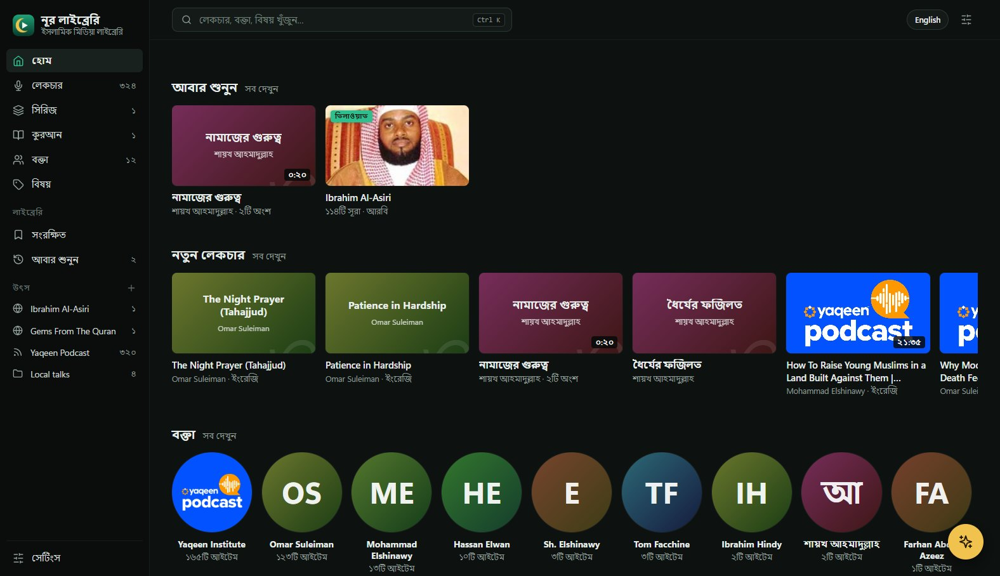
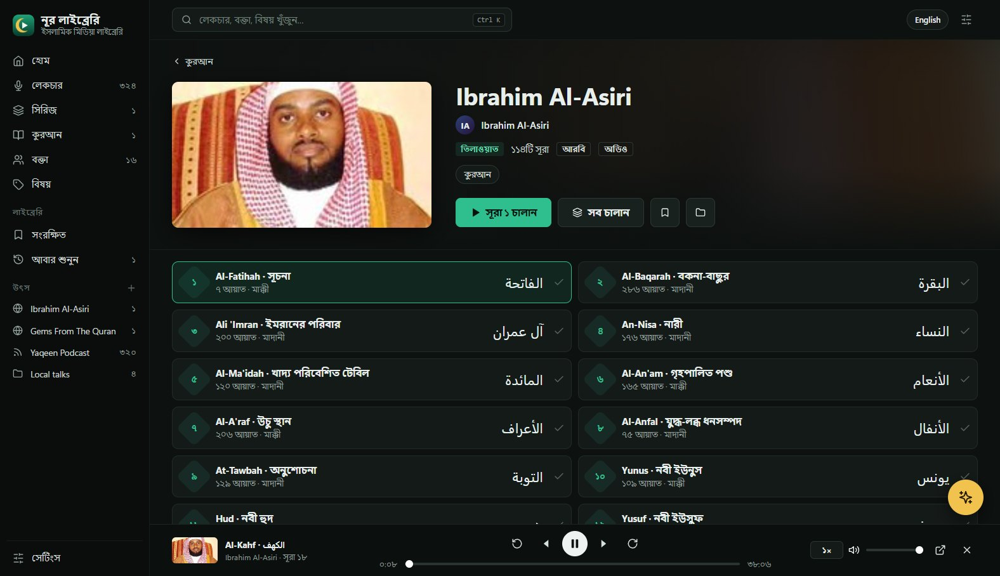
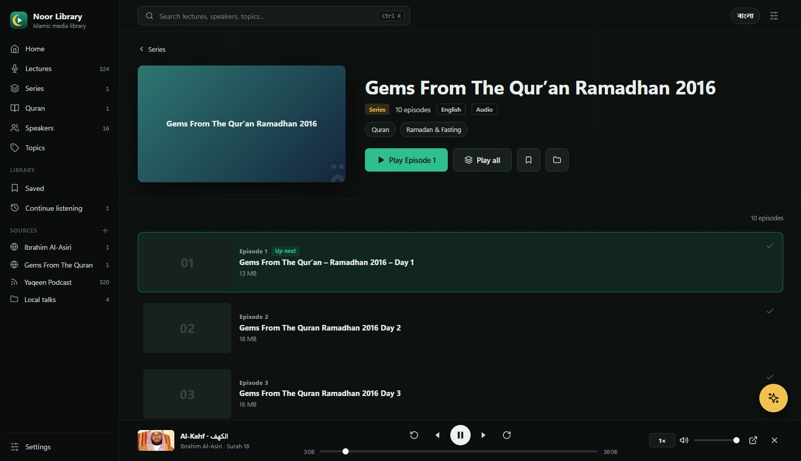
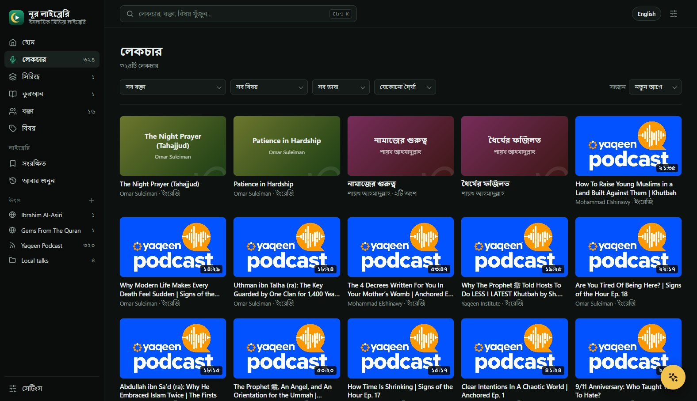
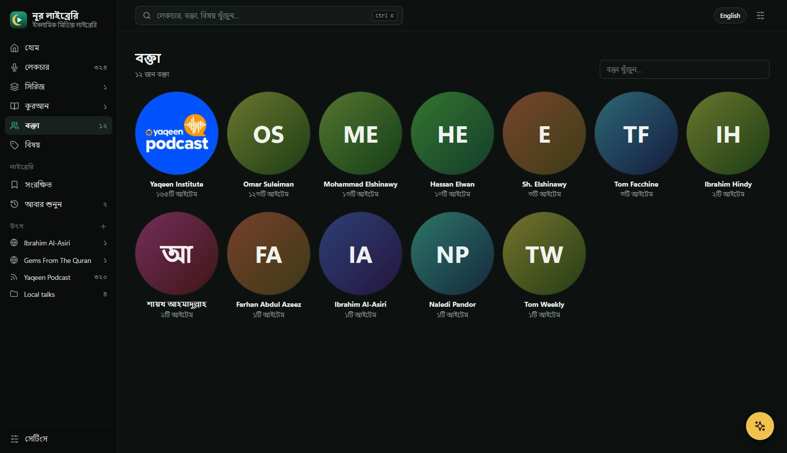
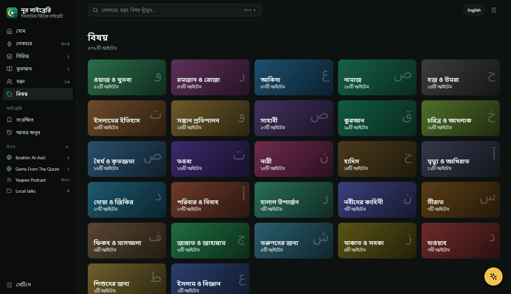
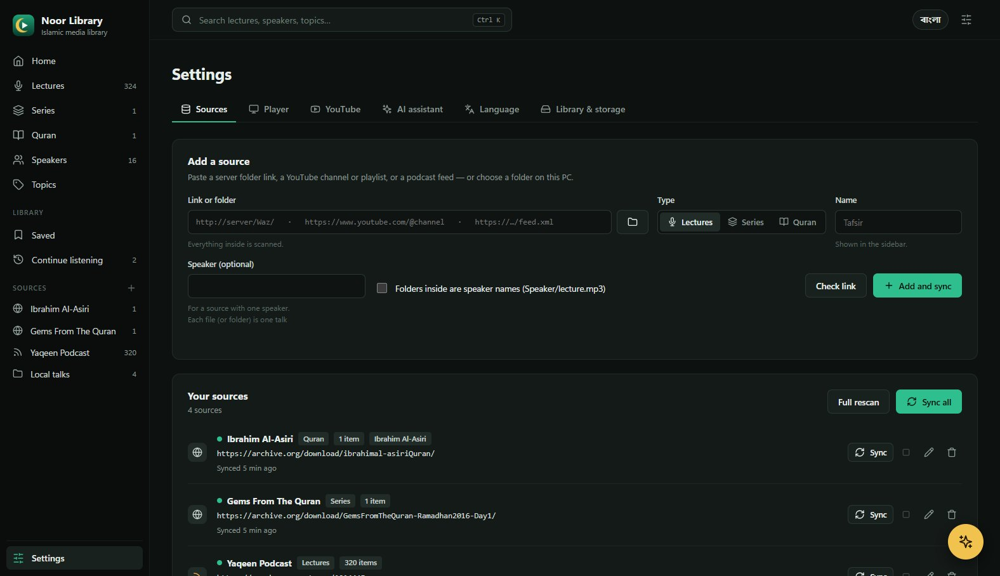

<div align="center">


# Noor Library · নূর লাইব্রেরি

**Your own Islamic media library for lectures, series, Quran recitations, films and documentaries, in Bangla and English.**

Add a server folder link, a folder on your PC, a YouTube channel or a podcast
feed. Noor Library brings them together in one calm, searchable library,
grouped by speaker and topic, with a built-in player that remembers where you
stopped.




</div>

---

## Why Noor Library?

Islamic lectures are scattered. Some sit on a local FTP or media server, some
on a hard drive, some on YouTube channels, and some in podcast apps. Each has
its own clumsy interface, and none of them remembers what you were listening
to.

Noor Library indexes all of them once and gives you one place to listen:

- 🎙️ **Lectures, series and Quran, each in its own section.** A folder of
  numbered files becomes one series with its episodes in order. A reciter's
  folder becomes one Quran title with all 114 surahs. Islamic films, dramas
  and documentaries (The Message, Ertuğrul, Omar…) get a *Films & Docs*
  section with seasons.
- 👤 **Browse by speaker.** It finds speakers from folder names, podcast
  authors and video titles ("… | Dr. Omar Suleiman").
- 🏷️ **Browse by topic.** Salah, Ramadan, Seerah, Family, Patience, Akhirah and
  24 more topics are detected from titles in English and Bangla.
- ▶️ **A built-in player that remembers your place.** It has speed control,
  ±15/30 s skips, a queue and *Continue listening*.
- 📺 **A YouTube-style watch page.** Videos play large, with views, likes,
  the description and an *Up next* list with autoplay. Browse away and the
  video shrinks into a corner mini-player and keeps playing.
- 🌐 **Bangla or English, with one click.** The interface, numbers and dates
  all switch, and surah names show in Arabic, English and Bangla.
- 🔒 **Private by design.** Everything stays on your PC: the library, your
  history and your keys. Nothing is uploaded.

## Screenshots

<table>
  <tr>
    <td width="50%"><br><sub><b>Quran:</b> 114 surahs with Arabic, English and Bangla names, and the player bar</sub></td>
    <td width="50%"><br><sub><b>Series:</b> episodes in order, with <i>Up next</i> picking up where you left off</sub></td>
  </tr>
  <tr>
    <td><br><sub><b>Lectures:</b> filter by speaker, topic, language, length and year</sub></td>
    <td><br><sub><b>Speakers:</b> every scholar in your library</sub></td>
  </tr>
  <tr>
    <td><br><sub><b>Topics:</b> lectures grouped by subject</sub></td>
    <td><br><sub><b>Sources:</b> paste a link or pick a folder, and Noor Library works out the rest</sub></td>
  </tr>
</table>

## Features

### Four kinds of sources

| Source | Example | What you need |
|---|---|---|
| 🌐 **Server folder link** | `http://172.16.50.4/Islamic/Waz/` | Any web server that shows a plain folder listing (FTP-style media servers, `python -m http.server`, nginx/Apache autoindex, archive.org) |
| 📁 **Folder on this PC** | `D:\Lectures\Tafsir` | Nothing |
| ▶️ **YouTube channel or playlist** | `https://www.youtube.com/@YaqeenInstitute` | A free YouTube Data API key (steps are in Settings › YouTube) |
| 📡 **Podcast feed** | `https://rss.buzzsprout.com/1014445.rss` | Nothing (RSS and Atom both work) |

When you add a source, **Check link** detects what the link is and suggests a
type: *Lectures*, *Series* or *Quran*. You can also set:

- **Speaker:** for a source where one speaker gives every talk.
- **Speaker folders:** for layouts like `Waz/<Speaker>/<talk>.mp3`.

### How it organises your files

| You have | Noor Library shows |
|---|---|
| `Speaker/01 Tawheed.mp3`, `Speaker/02 Tawheed.mp3` | One lecture, *Tawheed*, in 2 parts |
| `Tafsir/Part 1.mp3` … `Part 30.mp3` (as *Series*) | One series with 30 episodes in order |
| `Reciter/001.mp3` … `114.mp3` (as *Quran*) | One recitation with all 114 surahs, named |
| `talk.mp3` **and** `talk.wav` | A single item (the MP3 is preferred) |
| A YouTube channel (as *Lectures*) | One lecture per video, with the speaker taken from the title |
| A podcast (as *Series*) | One series with episodes ordered by date |
| `Ertugrul/Season 1/…`, `Season 2/…` (as *Films*) | One drama with a tab per season |
| A YouTube channel's Shorts | Left out, so the full talks aren't buried |

Episode numbers are read from `S01E02`, `Part 3`, `Episode 4`, `পর্ব ৫`,
`07 - …` and trailing numbers, in Bangla or Latin digits. A talk's language
(Bangla, English, Arabic, Urdu, Hindi) is detected from its title.

### Listening

- The built-in player handles MP3, M4A, AAC, OGG, Opus, WAV, FLAC, MP4 and
  WebM, and YouTube videos play in an embedded player.
- Formats the built-in player can't handle (WMA, AMR, MKV, AVI…) open in
  **VLC** or any player you choose.
- Your place is saved every few seconds. A talk counts as finished at 95%.
- *Play all* queues a whole series, or every surah from where you are.
- Save items to *Saved*, mark them as finished, or clear your history.

### AI assistant (optional)

Click ✨ and ask in Bangla or English, for example: *"ধৈর্য নিয়ে ছোট
বাংলা লেকচার"* ("a short Bangla lecture on patience") or *"Something for
Ramadan under 20 minutes"*.

The assistant uses Google Gemini and **only recommends items that are already
in your library**. It doesn't give religious rulings. For those, it points
you to relevant lectures and suggests asking a qualified scholar. It needs a
free Gemini API key from [Google AI Studio](https://aistudio.google.com/apikey).

## Install

### Option 1: build from source (Windows)

You need [Rust](https://rustup.rs) (stable) and the Microsoft Edge WebView2
runtime, which Windows 10 and 11 already include.

```powershell
git clone https://github.com/<you>/noor-library.git
cd noor-library
cargo build --release
```

This builds two programs in `target\release\`:

| Program | What it is |
|---|---|
| `noor-library.exe` | The desktop app: its own window, single instance |
| `noor.exe` | The command line: crawl, search, play, and serve the UI in a browser |

To install, copy `noor-library.exe` anywhere (for example
`%LOCALAPPDATA%\Programs\NoorLibrary\`) and make a shortcut. On first run it
creates its data folder at `%APPDATA%\NoorLibrary`.

### Option 2: command line

```powershell
noor -c config.toml crawl            # index every source
noor -c config.toml search tawheed   # search the index (offline)
noor -c config.toml play al kahf     # search, then open the best match in VLC
noor -c config.toml serve            # open the UI at http://127.0.0.1:8080
noor -c config.toml stats            # index size
```

See [`config.example.toml`](config.example.toml) for every setting.

## Getting started

1. Open **Noor Library**. The first page walks you through adding a source.
2. Paste a link or click 📁 to choose a folder, then click **Check link**.
3. Pick *Lectures*, *Series* or *Quran*, give the source a name, and click
   **Add and sync**.
4. Browse **Lectures**, **Series**, **Quran**, **Speakers** or **Topics**, or
   press <kbd>Ctrl</kbd>+<kbd>K</kbd> to search.

> 💡 **Free sources to try**
>
> - Internet Archive Quran recitations: `https://archive.org/download/<item>/`
> - The Yaqeen Institute podcast: `https://rss.buzzsprout.com/1014445.rss`

## How it works

```
 sources ──► crawler ──► SQLite (FTS5) ──► grouping ──► local web UI ──► WebView2 window
  HTTP folder listing      files, images,    lectures /    axum on 127.0.0.1
  local folder             checkpoints       series /      Host-checked,
  YouTube Data API v3                        Quran         serves /media with
  RSS / Atom feed                                          Range support
```

- **Crawler:** a breadth-first walk with checkpoints, so an interrupted
  sync carries on where it stopped. YouTube and feeds are read through their
  APIs.
- **Index:** SQLite with full-text search over file names, titles, speakers
  and topics, so search is instant and works offline.
- **Grouping:** turns files into lectures, series and Quran titles, detects
  speakers, topics and languages, and picks artwork. It skips the
  Internet Archive's auto-made waveform images.
- **UI:** plain HTML, CSS and JavaScript embedded in the binary, served only to
  `127.0.0.1`. The desktop app shows it in a native WebView2 window.

More detail is in [`docs/DESIGN.md`](docs/DESIGN.md).

## Privacy

- Everything lives in `%APPDATA%\NoorLibrary`: the config, the library
  database and your listening history.
- The app only contacts your own sources and, if you add keys, the YouTube
  Data API and Gemini. With the AI assistant, the titles that match your
  question are sent to Gemini so it can choose between them.
- The local server only answers requests addressed to `127.0.0.1`, plays
  only files in your index, and opens only a short allowlist of web pages.

## Built with

[Rust](https://www.rust-lang.org) ·
[axum](https://github.com/tokio-rs/axum) ·
[rusqlite](https://github.com/rusqlite/rusqlite) with SQLite FTS5 ·
[reqwest](https://github.com/seanmonstar/reqwest) ·
[scraper](https://github.com/causal-agent/scraper) ·
[roxmltree](https://github.com/RazrFalcon/roxmltree) ·
[tao](https://github.com/tauri-apps/tao) and [wry](https://github.com/tauri-apps/wry) ·
Surah names from [quran.com](https://quran.com).

<div align="center">
<br>
<sub>Made with care for everyone seeking beneficial knowledge.</sub>
</div>
